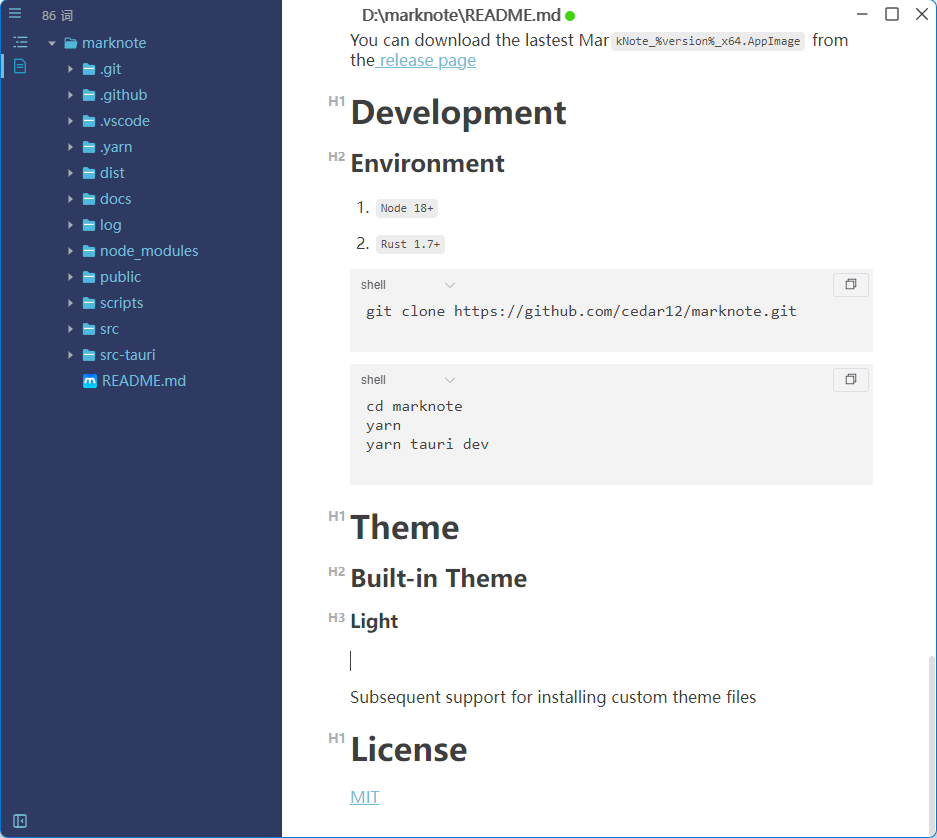
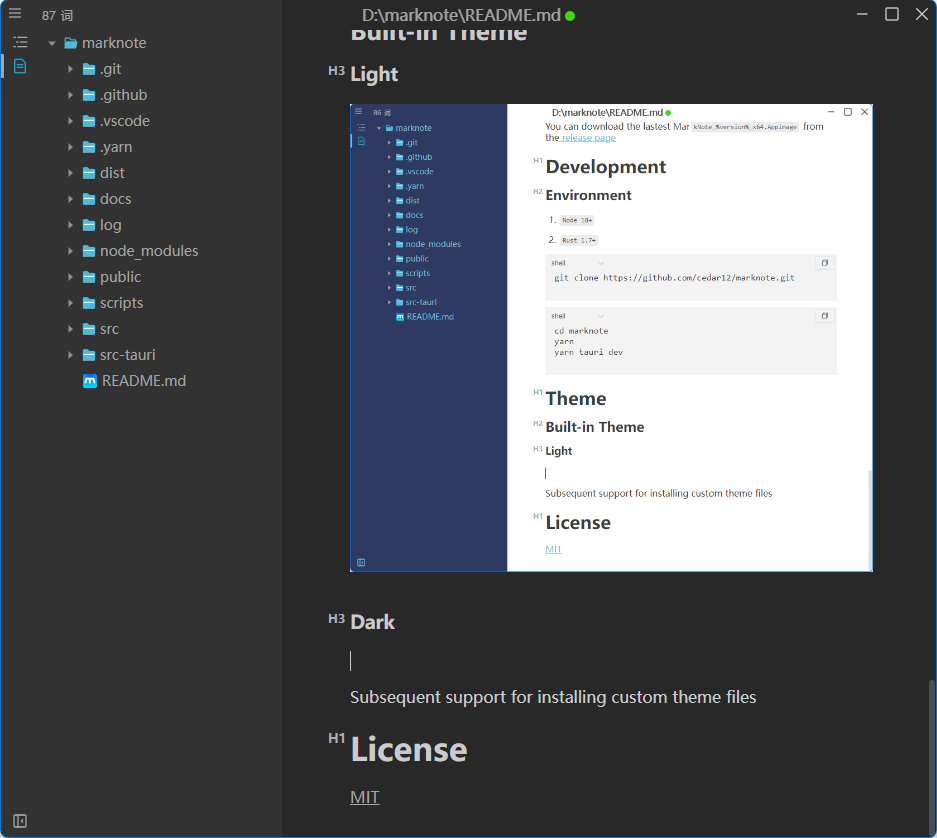

# MarkNote

Local recovery drafts preserve unnamed documents and the complete contents of segmented files. Reopening the app offers Restore copy, Later, or an explicit discard confirmation. Restoring opens an unsaved copy without overwriting the original file. Drafts remain on this computer until saved or discarded; each draft supports up to 128 MiB, and storage failures retain editor content with a retry action.

Changes made by another window or application retain your editor content and pause auto-save. A persistent notice offers Review differences, Reload, Save As, or explicitly confirmed Overwrite. The read-only comparison uses the complete current Markdown and latest disk snapshot; partial comparisons identify their limits and failed reads offer retry. Saving still stops if the file changes again after confirmation. Opening from a picker, recent files or a folder shares the same protection.

Unnamed documents accept pasted and dropped images, stored locally until saved. Unique filenames prevent collisions and failed uploads clean temporary caches. Save As copies referenced local images beside the target into `<document name>.assets` and rewrites their references, preserving originals. Missing attachments stop the save while retaining your document and draft. PicGo HTTP and CLI uploads must return an HTTP(S) image URL and time out after 30 seconds.

Quit and update installation check every document window. Cancelled or failed saves prevent the operation. Updates download first, then protect documents before installation. HTML, PDF, Word and image exports use complete snapshots, including all large-file segments and unsaved changes. HTML/PDF embed document resources; PDF exports have no 100-page limit.

Single replacement affects the current match, clearing search removes previous results, and Replace all is one undoable operation. Large-file segmentation preserves complete Markdown blocks and document-wide reference definitions. Code-block serialization uses safe fence lengths when the content contains backticks.

Whole document search (Ctrl/Cmd+Shift+F by default) finds literal Markdown across every segment and opens results at precise source positions. Replacement requires a preview and confirmation, then supports one source Undo. The list shows up to 300 results; Replace all separately scans up to 10,000 matches and requests a narrower query beyond that. Changed documents invalidate old results and IME composition keeps its own input behavior.

The search sidebar can recursively search `.md` and `.markdown` files in the open workspace, with cancellation, retry and skipped-file feedback. Limits are 2,000 files, 20,000 directory entries, 4 MiB per file, 64 MiB read, depth 32 and 300 results; links are skipped. Workspace search is read-only. Opening a result checks unsaved changes and validates the disk version before locating text. Browser previews support document search only.

The editor mode strip and View menu offer Rendered, Source and Split preview. Source edits the complete Markdown used by save, drafts, exports and search. An unchanged mode round trip retains rendered undo history; actual source edits restart rendered history while source undo remains available. Source history keeps up to 100 actions and 8 MiB of change records; a single action exceeding the budget preserves content and requests smaller edits. Split preview supports synchronized scrolling and identifies its nearby line window for large documents. Rendered formatting actions explain their disabled state while source is active.

Statistics can show the whole document or current segment. The most recent eight segments retain individual undo/redo, selection and scroll, within an additional approximate 16 MiB content/history budget. Evicted segments retain Markdown and position, but lose old undo history when reloaded. Ordinary prose edits reuse the outline and code decorations. Unknown-language code over 12,288 characters and known-language code over 262,144 characters render as plain text.

Folders support refresh, failed-read retry, empty states, and case-insensitive filtering of loaded names. Expand subfolders to include their items. The sidebar supports pointer and keyboard resizing; image settings include path selection, validation and persistent save feedback.

Closing a document window remembers its width and height. Startup and new windows restore the last closed document window's size in logical pixels, fitting the available display area when necessary. Minimizing does not overwrite the remembered size. Sidebar visibility and the preferred width also survive reopening; temporary narrowing in a small window retains the preferred width for a larger viewport.

[](https://github.com/cedar12/marknote/actions/workflows/release.yml)

🎉A simple `WYSIWYG` markdown editor, available for Linux, macOS and Windows.

---

# Features

- Multiple Window
- Whole-document source editing, split preview, document/workspace search and conflict comparison
- Multiple Themes, Support for custom themes
- Support CommonMark Spec, GitHub Flavored Markdown Spec
- Support paragraphs and inline style shortcuts
- Document Character and Word Statistics
- Supports pasting images from the clipboard and dragging external images for insertion
- Markdown extensions such as math expressions (KaTeX) and Mermaid Chart
- Support for exporting images, HTML, PDF, and Word (.docx) documents
- [PicGO](https://molunerfinn.com/PicGo/)

# Preview


[Complete Markdown example preview](docs/marknote.jpg)

# Download

[Latest stable release](https://github.com/cedar12/marknote/releases/latest), or [all releases](https://github.com/cedar12/marknote/releases) for prereleases. Choose Windows `.msi` / `.exe`, macOS `.dmg` for Intel or Apple silicon, or Linux `.deb` / `.AppImage` from the assets actually listed on that release.

# Development

## Environment

1. Node.js 22 with Corepack; the project pins Yarn 4.9.2.
2. Current Rust stable and the [Tauri platform prerequisites](https://v2.tauri.app/start/prerequisites/). Older Rust toolchains cannot read the current lockfile.

```shell
git clone https://github.com/cedar12/marknote.git
```

```shell
cd marknote
corepack enable
yarn install --immutable
yarn tauri dev
```

Run `yarn test:unit`, `yarn build`, `yarn test:browser`, and `cargo test --locked --manifest-path src-tauri/Cargo.toml --no-default-features`. Browser checks need Playwright and Chromium; optional `MARKNOTE_PLAYWRIGHT_PATH` and `MARKNOTE_BROWSER_PATH` select their locations. PRs and branch pushes run frontend, browser and native checks; tagged releases pass the same checks before building installers.

# Keyboard shortcuts

Open Preferences → Keyboard shortcuts, focus a field, and press a key combination to configure file, edit, format, paragraph, and view actions. Clear assignments, restore defaults, and resolve conflicts before choosing Save shortcuts. Changes apply immediately, synchronize across windows, and persist after restarting.

# Math block and Mermaid source

Select a math block or Mermaid diagram to show the source and copy buttons in the top right. Expand the source to edit it, or copy its raw text. Both source editors use the same code theme and styling; empty math blocks accept formula input immediately.

# Editor font

Open Preferences → Editor to choose system default, sans serif, serif, or monospace, or enter an installed font name and press Enter. Body size supports 12–32 px, with a live preview and Restore default font. Settings apply immediately, save automatically, and synchronize across windows while retaining document content and undo history. Unavailable fonts fall back to the system default; code keeps its monospace font.

# Image export

Use File → Export → Image to configure PNG or JPEG, document width, 1× / 2× resolution, background, and JPEG quality. The default 1× prioritizes speed; PNG supports transparency. Export includes the complete document, including all large-file segments, and uses the selected editor font. Settings remain available for retry after a failure.

# Markdown settings

Open Preferences → Markdown to configure single line breaks, link recognition, smart punctuation, HTML parsing, compact lists, bullet markers, and Markdown conversion on paste/copy. Settings save automatically and synchronize across windows.

Parsing settings apply to newly opened documents, pasted text, and loaded segments while retaining the current content, selection, and undo history. Output settings apply to future saves and copies; untouched large-file segments retain their original source. Paste As Plain Text and Copy As Plain Text keep plain-text behavior.

# Theme

## Built-in Theme

### Light



### Dark



## Custom Theme

### Install Theme

Open Preferences → Theme, select Install theme file, and choose a UTF-8 JSON file. Select the installed theme from the list to apply it. Installed themes are copied to the application data directory's `themes` folder (usually `%APPDATA%/com.github.marknote/themes` on Windows); the original file is retained.

Files can be up to 1 MiB and must include every field below. `label` is a nonempty name of 1–128 Unicode characters without control characters. `value` contains 1–128 ASCII letters, digits, hyphens, or underscores. `type` is `light` or `dark`. All 14 colors must use `#RGB`, `#RRGGBB`, or `#RRGGBBAA` notation. Additional fields are rejected.

Theme IDs are unique regardless of case. Duplicate installations are rejected, and `light` / `dark` are reserved IDs.

~~~json
{
  "label": "My Light Theme",
  "value": "my-light",
  "type": "light",
  "style": {
    "primaryBackgroundColor": "#2e3a62",
    "primaryBackgroundColorHover": "#334789",
    "primaryBackgroundColorActive": "#1f294a",
    "primaryTextColor": "#74bcd4",
    "primaryTextColorHover": "#4fb8db",
    "primaryTextColorActive": "#1e9fca",
    "primaryBorderColor": "#52b5f9",
    "contentBackgroundColor": "#ffffff",
    "contentBackgroundColorActive": "#ececec",
    "contentBackgroundColorHover": "#ececec",
    "contentTextColor": "#3e3e3e",
    "contentTextColorActive": "#4e4e4e",
    "contentTextColorHover": "#c4c4c4",
    "contentBorderColor": "#babec1"
  }
}
~~~

### Uninstall Theme

Select Uninstall below an installed theme and confirm. Removing the active theme applies the built-in theme of the same type in every window. Built-in and bundled themes cannot be uninstalled. Cancelling a picker or confirmation preserves the theme; file failures show a recoverable error.

# License

[MIT](https://github.com/cedar12/marknote/blob/main/LICENSE)
